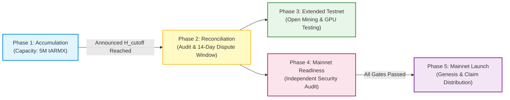
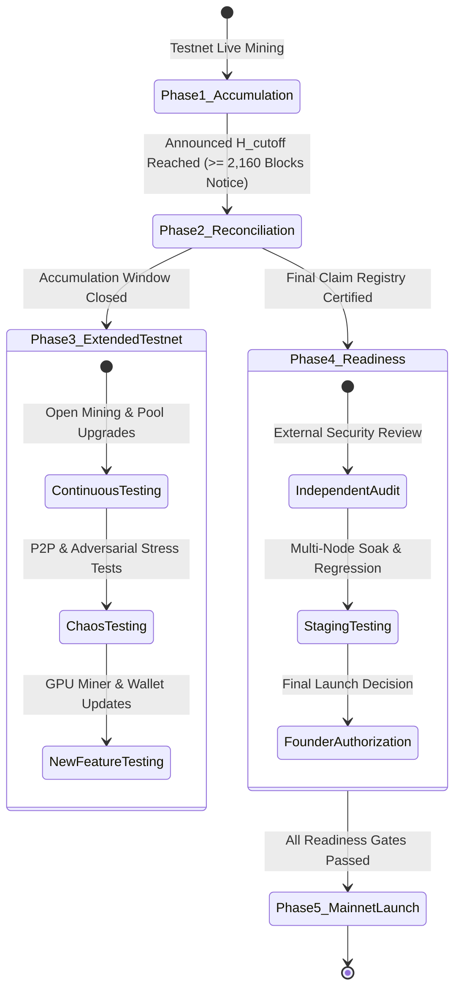
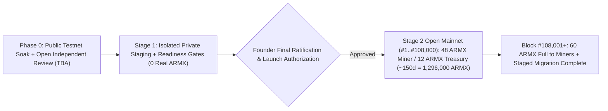

# Armaxcoin Treasury & Mainnet Open-Launch Subsidy Split Plan

**Version:** 1.3 (Preliminary Non-Final Plan)  
**Date:** November 27, 2026  
**Status:** PRELIMINARY PLAN — NOT FINAL (Non-binding Draft for Evaluation and Approval)  
**Scope:** Proposed Two-Stage Launch Path (Staging Readiness First -> Open Public Mainnet from Block `#1` with `80% / 20%` On-Chain Block Subsidy Split [`48 ARMX` Miner / `12 ARMX` Treasury] Across Blocks `#1..#108,000` [`~150` Days / `1,296,000 ARMX`]), Conservative Treasury Allocation Ceilings, Developer & Community Contributor Principles, and Staged Testnet Miner Migration (`tARMX` -> `ARMX`)  
**Document Type:** Preliminary Non-Final Policy Plan *(Not an implementation, not a launch authorization, and not a binding financial commitment)*

> [!IMPORTANT]
> **CRITICAL DISCLAIMER (PRELIMINARY NON-FINAL PLAN):**  
> This document is a **preliminary, non-final policy plan** subject to revision, ongoing technical evaluation, and formal approval. Publishing specific numerical ceilings or illustrative tables here does **not** create vested rights or guaranteed payouts, and a legal disclaimer alone cannot prevent misunderstandings unless expectations remain clear and understated.  
> - **Mainnet Status:** Mainnet (`ARMX-MAINNET-1`) remains locked in source code (`core.MainnetLaunched = false`). Nothing in this document authorizes Mainnet launch, consensus changes, token distribution, or Treasury transfers.  
> - **Testnet Status (`tARMX`):** The public testnet timeline is **open-ended (`TBA` / undetermined)** and depends on completing all Mainnet readiness gates and open independent security reviews in [`docs/MAINNET_READINESS.md`](../MAINNET_READINESS.md). Testnet coins (`tARMX`) currently have **no market price or liquidity**. While verified external community mining rewards are planned for future Mainnet migration, final ratios, eligibility reconciliation, and snapshot dates remain **non-final (`TBA`)**.  
> - **Not an Investment Offer:** This plan is **not an investment offer, not a promise of market liquidity or price performance, and not financial advice**. No allocation becomes payable merely by appearing in this draft.

---

## Table of Contents
- [Plain-Language Guide for Testnet Miners](#plain-language-guide-for-testnet-miners)
1. [Objective and Mainnet Consensus Invariants](#1-objective-and-mainnet-consensus-invariants)
2. [Two-Stage Launch Path and 108,000-Block 80%/20% Subsidy Split Calculation](#2-two-stage-launch-path-and-108000-block-8020-subsidy-split-calculation)
3. [Proposed Allocation of 1,296,000 ARMX](#3-proposed-allocation-of-1296000-armx)
4. [Core Developer Team Allocation and Vesting Proposal](#4-core-developer-team-allocation-and-vesting-proposal)
5. [Community Contributors Allocation Proposal](#5-community-contributors-allocation-proposal)
6. [Testnet Miner Migration (Up to 500,000 ARMX / 5,000,000 tARMX)](#6-testnet-miner-migration-up-to-500000-armx--5000000-tarmx)
   - [6.1 Three-Category Event Accounting & Oversubscription Policy](#61-three-category-event-accounting--oversubscription-policy)
   - [6.2 Preserved Eligibility & Reconciliation Rules (Dual-Lock Event-Based Model)](#62-preserved-eligibility--reconciliation-rules-dual-lock-event-based-model)
   - [6.3 Decoupling Policy: Migration Snapshot ≠ Testnet Shutdown ≠ Mainnet Launch](#63-decoupling-policy-migration-snapshot--testnet-shutdown--mainnet-launch)
   - [6.4 Five-Phase Testnet & Migration Lifecycle Architecture](#64-five-phase-testnet--migration-lifecycle-architecture)
   - [6.5 Pre-Snapshot Testnet Mining Transparency Dashboard & Richlist Specification](#65-pre-snapshot-testnet-mining-transparency-dashboard--richlist-specification)
   - [6.6 Community Disclosure Policy & Pre-Snapshot Communication](#66-community-disclosure-policy--pre-snapshot-communication)
   - [6.7 Developer & Project Risk Mitigation Matrix](#67-developer--project-risk-mitigation-matrix)
7. [Future Bridge and Cross-Chain Reserve (200,000 ARMX)](#7-future-bridge-and-cross-chain-reserve-200000-armx)
8. [Operations and Uncommitted Treasury Reserve](#8-operations-and-uncommitted-treasury-reserve)
9. [Supply, Concentration, and Operational Risks](#9-supply-concentration-and-operational-risks)
10. [Wallet Structure, Custody Controls, and Governance Transparency](#10-wallet-structure-custody-controls-and-governance-transparency)
11. [Implementation Roadmap and Verification Checklist](#11-implementation-roadmap-and-verification-checklist)
12. [Historical Testnet Migration Simulation (Block #16,121 & Block #22,990 Snapshots)](#12-historical-testnet-migration-simulation-block-16121--block-22990-snapshots)
13. [Decision Boundaries, Unresolved Decisions, and Conclusion](#13-decision-boundaries-unresolved-decisions-and-conclusion)

---

## Plain-Language Guide for Testnet Miners

This plain-language summary explains how the Testnet migration program fits into this preliminary `v1.3` bootstrap draft:

- **Why Testnet miner migration is being considered:** Community miners spend real electricity, hardware, and troubleshooting time testing `ARMX-TESTNET-1`. Under this preliminary plan, up to **`500,000 ARMX`** (accommodating up to **`5,000,000 eligible tARMX`** at the candidate `10:1` ratio, with a **`500,000 tARMX` per-wallet cap**) is reserved in planning scenarios to migrate verified external community mining rewards when Mainnet launches.
- **Who may be eligible:** External solo miners and pool miners whose rewards come from canonical Testnet coinbase blocks or verified pool payouts. Developer test wallets, faucet claims, and ordinary peer-to-peer transfers receive **`0 ARMX`**.
- **Why ordinary transfers and faucet coins are excluded:** Ordinary transfers can be sent back and forth endlessly, so attaching `0 ARMX` entitlement to transfers prevents artificial inflation and protects honest miners from dust spam. Faucet claims (`10.0 tARMX`) are free testing coins, not Proof-of-Work mining.
- **Why snapshot reconciliation is required:** Pool coinbase rewards land in the pool wallet first and are then split among miners. Reconciling on-chain history with pool payout ledgers prevents double-counting and cleanly excludes developer test addresses.
- **Core Decoupling Invariant (`Migration Snapshot ≠ Testnet Shutdown ≠ Mainnet Launch`):** Reaching the `5,000,000 tARMX` target only caps Phase 1 migration accumulation. It does **not** shut down `ARMX-TESTNET-1` (which continues indefinitely in Phase 3 for GPU/pool testing), nor does it trigger Mainnet launch (which is governed separately by independent security review gates in Phase 4).
- **What is planned vs. what remains undecided (`TBA`):**
  - *Planned direction:* Software readiness and stability testing run **first** on an isolated staging network (zero real Mainnet coins). Once ready, `ARMX-MAINNET-1` opens **directly to all public miners from Block `#1`** with **zero premine** and **zero pre-public private mining**. Under this preliminary `v1.3` plan, Mainnet consensus rules on **Blocks `#1..#108,000`** (`~150` days at `120s` target spacing) split each `60 ARMX` block subsidy into **`48 ARMX` (`80%`) + `100%` of fees to the miner** and **`12 ARMX` (`20%`) to the fixed protocol Treasury address** (`108,000 × 12 = 1,296,000 ARMX`), returning to the full **`60 ARMX` + fees** for miners from **Block `#108,001`** onward. Up to **`500,000 ARMX`** (`5,000,000 eligible tARMX` at `10:1`) is reserved for Testnet miner migration and fulfilled in **staged tranches** as Treasury coinbases become spendable (consensus `CoinbaseMaturity = 100`) **and** reach the operational `>= 720`-confirmation finality threshold (`MaxReorganizationDepth`, `~24` hours) through Block `#108,000`.
  - *Use a new Mainnet wallet:* Mainnet addresses use their own prefix (`ax1…`), distinct from Testnet (`armx1…`). Migration payouts go to a **new** Mainnet address that you bind to your Testnet mining address with a signed claim—never import a Testnet keystore into a Mainnet wallet.
  - *Still preliminary:* Everything—including final ratification of the `80% / 20%` Open-Launch Subsidy Split parameters, the candidate **`10 tARMX : 1 ARMX`** ratio, snapshot block height/date, and claim tranche schedules—remains **non-final (`TBA`)** until separate Founder approval. `tARMX` has **no current market price, liquidity, or guaranteed return**.

---

## 1. Objective and Mainnet Consensus Invariants

Revision `v1.3` updates the earlier `v1.2` (`1,000,000 ARMX` / `16,667`-block private mining) draft in [`mining-accumulation-plan.md`](../architecture/tokenomics/mining-accumulation-plan.md) to eliminate pre-public private mining completely via a **Two-Stage Open-Launch Path**:
1. **Stage 1 — Separate Private Staging Readiness First:** Run protocol, soak, and adversarial testing on an isolated staging network (producing zero real `ARMX`) until Mainnet readiness gates are completed—avoiding the risk of resetting Mainnet for late bugs.
2. **Stage 2 — Open Public Mainnet from Block `#1` with `80% / 20%` Subsidy Split (`Blocks #1..#108,000`, `1,296,000 ARMX`):** Once Stage 1 readiness is verified and formally approved by the Founder, `ARMX-MAINNET-1` opens directly to public P2P mining from **Block `#1`** (`0` private blocks). Mainnet consensus enforces a temporary `20%` protocol Treasury split (`48 ARMX` miner + fees / `12 ARMX` Treasury per block) across **Blocks `#1..#108,000`** (`~150` days, accumulating `1,296,000 ARMX` exact), then permanently restores **`60 ARMX` full miner rewards** from **Block `#108,001`** onward.

### Mandatory Consensus & Ledger Invariants

Except for the explicitly bounded Mainnet subsidy-split rule proposed in Stage 2 (which is not yet implemented in source and remains subject to Founder ratification and open independent security review), nothing in this policy draft alters Layer-1 protocol rules:

- **Maximum Supply:** `126,000,000 ARMX` strict ceiling (`1 ARMX = 100,000,000 Armoids`).
- **Initial Block Subsidy:** `60 ARMX` total base subsidy per canonical block (never exceeded; `48 + 12 = 60 ARMX` on Mainnet `#1..#108,000`, `60 ARMX` full from `#108,001` onward).
- **Target Block Interval:** `120` seconds (`2` minutes).
- **Halving Interval:** Every `1,050,000` blocks (~`4` years at target spacing).
- **No Emission Outside Consensus:** Treasury balances can only originate from valid consensus block subsidies under Layer-1 rules—never through preminted off-rule coins or hardcoded supply inflation.
- **Transparent Consensus Subsidy Split (Mainnet `#1..#108,000` Only; Not Yet Implemented in Source):** Under this proposed `80% / 20%` subsidy-split rule, the `12 ARMX/block` Treasury share applies strictly and deterministically to `ARMX-MAINNET-1` Blocks `#1..#108,000` via a dedicated consensus coinbase output (`tx[1]`, `CoinbaseMaturity = 100`) to a single pre-announced `M-of-N` multisig Treasury address; `100%` of user transaction fees remain with the block miner (`tx[0]`), `ARMX-TESTNET-1` remains `0%` split, and this rule must be implemented and independently reviewed before `core.MainnetLaunched` is enabled. The byte-level contract is specified in [`mainnet-treasury-subsidy-split.md`](../architecture/consensus/mainnet-treasury-subsidy-split.md).
- **Genesis & Profile Preservation:** Historical Testnet (`ARMX-TESTNET-1`) genesis, blockchain history, Network IDs, address prefix (`armx1…`), databases, wallets, and consensus schedules are **not** modified. Mainnet genesis (`core/genesis.go`) keeps its economics (`60 ARMX` burned to the canonical zero-payload address, `0 ARMX` to Treasury); under the proposed per-network address prefix (Mainnet `ax`), that burn address is encoded as `ax1qqqqqqqqqqqqqqqqqqqqqqqqqqqqqqqqqqqqqqqqqqqqqqqqqqqqyum580`, which changes the (not yet launched) Mainnet genesis hash only.
- **Mainnet Launch Lock Remains Active:** `core.MainnetLaunched = false` stays unchanged until independently authorized after satisfying [`docs/MAINNET_READINESS.md`](../MAINNET_READINESS.md).
- **Custody Tooling Clarification:** Do not assume the Armaxcoin protocol already contains tested trustless time-locks or on-chain multisig covenants. Unless independently implemented and reviewed in source code, all vesting locks and custody controls described below are **proposed operational/policy mechanisms (`TBA`)**.

---

## 2. Two-Stage Launch Path and `108,000`-Block `80%/20%` Subsidy Split Calculation

### 2.1 Exact `108,000`-Block Issuance Calculation *(Consensus Cutoff: Block `#108,000`)*

Assuming the target block spacing and initial `60 ARMX` block subsidy hold across `108,000` Mainnet blocks (`#1..#108,000`, with no halving before `#1,050,000`):

- **Genesis (`#0`):** `60 ARMX` burned to the canonical zero-payload address (`0 ARMX` to Treasury): `ax1qqqqqqqqqqqqqqqqqqqqqqqqqqqqqqqqqqqqqqqqqqqqqqqqqqqqyum580` under the proposed Mainnet prefix (the Testnet equivalent remains `armx1qqqqqqqqqqqqqqqqqqqqqqqqqqqqqqqqqqqqqqqqqqqqqqqqqqqqplwcdd`).
- **Split Window (`Blocks #1..#108,000`, `108,000` blocks):**
  - **Miner Share (`80%`):** `48 ARMX` (`4,800,000,000 Armoids`) + `100%` of transaction fees per block = **`5,184,000 ARMX`** (+ all fees) to public miners.
  - **Treasury Share (`20%`):** `12 ARMX` (`1,200,000,000 Armoids`, `0` fees) per block = **`1,296,000 ARMX`** exact (`108,000 × 12 = 1,296,000 ARMX`, zero fractional remainder block).
  - **Total Base Emission (`#1..#108,000`):** `108,000 × 60 ARMX = 6,480,000 ARMX` (`20%` Treasury / `80%` Miners).
- **Post-Split Era (`Blocks #108,001..#1,049,999`):** Treasury split ends permanently (`0 ARMX`); miners receive **`60 ARMX` (`100%`) + `100%` of transaction fees** per block until the first halving at Block `#1,050,000`.
- **Estimated Duration (`120s` target spacing):** `86,400 / 120 = 720` expected blocks/day → `108,000 / 720 = 150` expected days (`~5` months).

```text
Blocks #1..#108,000 (108,000 blocks, ~150 days at 120s/block):
  48 ARMX (+ 100% tx fees) -> Block Miner (5,184,000 ARMX total base subsidies)
  12 ARMX (0 tx fees)       -> Fixed Protocol Treasury (1,296,000 ARMX exact)
Block #108,001 onward:
  60 ARMX (+ 100% tx fees) -> Block Miner (0 ARMX to Treasury)
```

**Measurement & Accuracy Caveats:**
1. **Block-Height Cutoff, Not Calendar Cutoff:** The consensus split ends strictly at **Block `#108,000`**, not after `150` calendar days. Under Proof-of-Work and `Armax-ASERT-AW`, actual wall-clock duration varies with network hashrate.
2. **No Oversupply or Premine:** Every `ARMX` in Treasury comes from the standard `60 ARMX` block subsidy as public miners mine blocks `#1..#108,000`.
3. **Opening Height Confirmation Required:** Before Mainnet launch freeze, exact split parameters (`TreasuryAddress`, `TreasurySplitEndHeight = 108000` on `MainnetProfile`; a short local window on Regtest for end-to-end testing; `-1` = disabled on Testnet and Soak) must be verified in `core/network.go`, `core/state.go`, `core/blockchain.go`, `node/server.go`, and `miner/miner.go`. Because Mainnet has no chain yet, the rule applies from genesis and needs **no activation block or hard fork**; enabling it on `ARMX-TESTNET-1` would require a separately authorized, coordinated activation height.

### 2.2 Two-Stage Open-Launch Architecture & Transparency Safeguards

To prevent both pre-public private mining and premature Mainnet resets, this preliminary plan separates isolated staging verification from open public Mainnet launch:

- **Stage 1 — Isolated Private Staging First (`0` Real Mainnet `ARMX`):**
  - Runs all protocol stabilization, soak testing, adversarial readiness checks, and [`docs/MAINNET_READINESS.md`](../MAINNET_READINESS.md) open independent reviews **first** on an **isolated staging Network ID, separate genesis block, and separate database** (`0` real Mainnet `ARMX` mined)—ensuring the real Mainnet chain is **never** reset for software bugs.
  - **Strict Honesty Rule:** Staging coins produced during Stage 1 testing must **never** be represented, distributed, or swapped as real Mainnet `ARMX`.
- **Stage 2 — Open Public Mainnet from Block `#1` with `12 ARMX/Block` Treasury Split (`#1..#108,000`, `1,296,000 ARMX`):**
  - Once Stage 1 readiness is complete and Founder authorization is signed, `ARMX-MAINNET-1` opens immediately to all public P2P miners at **Block `#1`** (`0` premine, `0` private blocks). Consensus splits each `60 ARMX` subsidy on **Blocks `#1..#108,000`** (`~150` days at `120s`, accumulating **`1,296,000 ARMX`**, `~1.03%` of `126M` max supply) into **`48 ARMX` + `100%` of fees (miner)** and **`12 ARMX` (Treasury)**, restoring **`60 ARMX` + fees** at **Block `#108,001`**.
- **Public Read-Only Explorer & Pre-Launch Transparency Requirement:**
  1. An **isolated read-only public Explorer** (connected to a dedicated read-only mirror node; zero private keys on the web server; `/faucet` and `/tx/new` disabled) displays live `Miner (48 ARMX)` vs `Treasury (12 ARMX)` coinbase splits, cumulative Treasury balance, and remaining blocks until `#108,000`.
  2. **Mandatory Pre-Launch Disclosure Package:** Before Block `#1` opens, publish the immutable `MainnetProfile` Treasury address, custody/multisig signers, dual-coinbase consensus specification, and block-height schedule (`#1..#108,000`).

> [!CAUTION]
> **Preliminary Status (Requires Consensus Implementation & Founder Authorization):**
> Documenting this Two-Stage Open-Launch `80%/20%` Subsidy Split (`Blocks #1..#108,000` / `1,296,000 ARMX`) aligns `armax-coin` planning documents under a single candidate framework with zero pre-public private mining, **but it remains PRELIMINARY AND NON-FINAL**. Nothing in this document authorizes Mainnet launch (`core.MainnetLaunched` stays `false`) or activates dual-coinbase consensus rules without separate implementation, open independent security review, and Founder sign-off.

---

## 3. Proposed Allocation of `1,296,000 ARMX`

*(Applicable as a conservative planning ceiling framework once the `108,000`-block `80% / 20%` subsidy split yielding `1,296,000 ARMX` is formally implemented, reviewed, and approved; **not** a guaranteed spend or vested payout commitment, and accrued gradually over `#1..#108,000`.)*

| Category | Maximum Planning Ceiling | Share of `1,296,000 ARMX` | Notes & Status |
|---|---:|---:|---|
| **Core Developer Team** | `100,000 ARMX` | `7.72%` | Maximum planning pool; contribution-scored & proposed 24-month vesting (Section `4`) |
| **Community Contributors** | `200,000 ARMX` | `15.43%` | Maximum planning pool for non-mining contributors; contribution-verified (Section `5`) |
| **Testnet Miner Migration** | Up to `500,000 ARMX` | `38.58%` | Accommodates up to `5,000,000` eligible `tARMX` at `10:1` (`500,000 tARMX` per-wallet cap); Dual-Lock verified claims fulfilled in **staged tranches** as Treasury coinbases mature (Section `6`) |
| **Future Bridge / Cross-Chain Reserve** | `200,000 ARMX` | `15.43%` | Uncommitted conditional reserve; not automatic collateral or LP (Section `7`) |
| **Operations & Infrastructure** | `50,000 ARMX` | `3.86%` | Reimbursable/budgeted infrastructure, seeds, telemetry & security response (Section `8`) |
| **Uncommitted Treasury Reserve** | `246,000 ARMX` | `18.98%` | Unallocated reserve kept offline unless separately approved & disclosed (Section `8`) |
| **Total Planning Scenario** | **`1,296,000 ARMX`** | **`100.00%`**\* | **Conservative `108,000`-block (`~150`-day) `20%` subsidy-split ceiling model** |

*\*Rounded to two decimal places: `7.72 + 15.43 + 38.58 + 15.43 + 3.86 + 18.98 = 100.00%`.*

### Mandatory Allocation Policy Conditions
1. **Planning Ceilings, Not Entitlements:** Every figure above is an upper planning cap, **not** an accrued salary, vested debt, or guaranteed reward.
2. **No Automatic Liability:** Publishing a category cap creates **zero** enforceable claim or payout obligation on the project.
3. **Unused Ceilings Stay in Treasury:** Any unallocated or unclaimed portion (for instance, `Testnet Miner Migration` claims below `500,000 ARMX`) remains unspent in Treasury rather than overflowing into developer or marketing budgets.
4. **Uncommitted Reserve Is Not Planned Spending:** Keeping `246,000 ARMX` (`18.98%`) uncommitted reflects restraint—it must **not** be portrayed as active spending or liquidity deployment.
5. **Intentional Non-Proportional Design (`v1.2` -> `v1.3`):** Earlier `v1.2` modeled `1,000,000 ARMX` via private mining (`16,667` blocks) with a `300,000 ARMX` migration cap. Revision `v1.3` replaces pre-public private mining with an **open-launch `80%/20%` subsidy split (`Blocks #1..#108,000`, `1,296,000 ARMX`)** without scaling spending buckets proportionally: `Testnet Miner Migration` rises to **`500,000 ARMX`** (`5,000,000 eligible tARMX` at `10:1` with a `500,000 tARMX` per-wallet cap, disbursed in staged tranches as Treasury coinbases mature), `Operations` (`50,000 ARMX`), conditional `Bridge/Cross-Chain Reserve` (`200,000 ARMX`), Core Dev (`100k`) & Community Contributors (`200k`) remain capped, and **`246,000 ARMX`** (`18.98%`) stays Uncommitted Treasury Reserve.
6. **No Market or Price Promises:** Nothing here commits Treasury funds to AMM price floors, exchange market-making, token price targets, or financial returns.

---

## 4. Core Developer Team Allocation and Vesting Proposal

- **Maximum Core Developer Team Planning Pool:** **`100,000 ARMX`** (`~7.72%` of `1,296,000 ARMX`, `~0.079%` of `126,000,000 ARMX` max supply).
- **Eligibility Standard:** Allocations must be **contribution-based, never title-based**. Merely holding a repository label or social role grants `0 ARMX`.
- **Eligible Contributor Functions *(Subject to Individual Verification)*:**
  - Owner / Founder
  - Core Maintainer
  - Active Developer
  - Organization Member performing verified engineering work
  - Technical Contributor with verifiable ongoing maintenance or security responsibilities

### 4.1 Proposed Contribution Scoring Framework (`100%` Total Weight)

| Evaluation Dimension | Weight | Verifiable Evidence Criteria |
|---|---:|---|
| **Engineering & Feature Implementation** | `35%` | Merged consensus, P2P, cryptography, wallet, CLI, GUI, or explorer engineering PRs |
| **Maintenance, Code Review & Bug Fixing** | `25%` | Defect resolution, PR code reviews, dependency maintenance, release verification |
| **Security, Testing & Reliability** | `20%` | Race/fuzz/regression tests, threat-model hardening, reproducible vulnerability triage/fixes |
| **Documentation & Contributor Support** | `10%` | Technical specs, operator guides, issue triage, helping external contributors land changes |
| **Long-Term Consistency & Responsibility** | `10%` | Sustained stewardship across release cycles without abandoned commitments |
| **Total** | **`100%`** | **Scored strictly on documented public/verifiable work** |

### 4.2 Illustrative 8-Person Distribution Example *(Hypothetical Only)*

> [!NOTE]
> **Hypothetical Illustration Only — Non-Binding:**  
> Letters `A`–`H` below are purely arithmetic examples illustrating how weighted scores (`500` total points -> `200 ARMX/point`) divide `100,000 ARMX`. **No actual individuals have been assigned grants, scores, or shares**, and no real recipient names are invented. Currently `@acxxcxx` performs maintenance alone; if fewer qualified core developers exist at approval time, unused ceiling remains in Treasury rather than defaulting automatically to one recipient without review.

| Illustrative Member | Hypothetical Contribution Points | Illustrative Ceiling Allocation | Share of `100,000 ARMX` Pool |
|---|---:|---:|---:|
| `A` *(Hypothetical)* | `100` | `20,000 ARMX` | `20.0%` |
| `B` *(Hypothetical)* | `90` | `18,000 ARMX` | `18.0%` |
| `C` *(Hypothetical)* | `80` | `16,000 ARMX` | `16.0%` |
| `D` *(Hypothetical)* | `70` | `14,000 ARMX` | `14.0%` |
| `E` *(Hypothetical)* | `60` | `12,000 ARMX` | `12.0%` |
| `F` *(Hypothetical)* | `50` | `10,000 ARMX` | `10.0%` |
| `G` *(Hypothetical)* | `30` | `6,000 ARMX` | `6.0%` |
| `H` *(Hypothetical)* | `20` | `4,000 ARMX` | `4.0%` |
| **Total (`8` Illustrative Slots)** | **`500` pts** | **`100,000 ARMX`** | **`100.0%`** |

### 4.2a Conflict-of-Interest Safeguards (Solo-Maintainer Reality)

The project currently has a single maintainer and no DAO or independent committee. Rather than inventing a nominal "independent committee" (governance theater), any Core Developer grant—including one to the Founder—must satisfy all of the following verifiable constraints:
1. **Hard Ceiling:** Total Core Developer grants never exceed `100,000 ARMX`; unused ceiling stays in Treasury.
2. **Public Evidence Window (`>= 14` days):** The proposed recipient list, contribution scores, and supporting public evidence (merged PRs, releases, reviews, security fixes) are published at least `14` days before any grant is fixed, so the community can check the evidence.
3. **No Double-Dipping:** The same work cannot be rewarded from both the Core Developer pool and the Community Contributors pool, nor counted again under Testnet miner migration (developer-controlled mining is already `0 ARMX`, Section `6.2`).
4. **Cliff and Vesting:** Every grant follows the `12`-month cliff and `24`-month vesting in Section `4.3`, disbursed under the multi-party custody controls in Section `10.2`.

### 4.3 Proposed Developer Vesting Schedule (`24` Months)

Any separately approved Core Developer grant is proposed to follow a **two-year vesting timeline**:
- **Months `0`–`11`:** `0%` unlocked (**`12`-month cliff** from formal Mainnet public launch / grant effective date).
- **Month `12`:** **`25%`** of approved grant unlocks *(initial cliff tranche)*.
- **Month `16`:** Another **`25%`** unlocks *(cumulative `50%`)*.
- **Month `20`:** Another **`25%`** unlocks *(cumulative `75%`)*.
- **Month `24`:** Final **`25%`** unlocks *(cumulative `100%`)*.

**Critical Safeguards on Developer Vesting:**
1. **Policy Vesting vs. Protocol Time-Lock:** Armaxcoin consensus (`core/`) does **not** currently implement a verified trustless covenant/time-lock script. Unless protocol-level time-locks are separately built, reviewed, and audited before use, this schedule is enforced through **Treasury custody policy and staggered disbursements**—and must **not** be falsely advertised as "cryptographically unspendable on-chain."
2. **No Pre-Approval Entitlement:** No person holds any claim or vested balance until (a) the recipient list, (b) verified contribution assessment, and (c) exact grant amounts receive separate formal approval.

---

## 5. Community Contributors Allocation Proposal

- **Maximum Community Contributors Planning Pool:** **`200,000 ARMX`** (`~15.43%` of `1,296,000 ARMX`).
- **Eligible Contribution Types *(Non-Exhaustive Examples)*:**
  - Accepted source-code contributions (Core, wallet, miner, explorer, tools).
  - Detailed, reproducible bug reports and diagnostic logs.
  - Structured release testing, soak testing, and QA verification.
  - Documentation improvements, newcomer guides, and accurate translations.
  - Hands-on testing across `armwallet`, `armminer`, `armgui`, and `armax_explorer`.
  - Public node operation, seed node reliability, and infrastructure troubleshooting.
  - Verifiable technical support helping newcomers solve setup or sync issues.

### Core Fairness Rules for Community Grants
1. **No Participation-Trophy Splits:** Equal payouts must **never** be handed out merely for joining Telegram or following a GitHub account. Recognition must tie to verifiable, helpful contributions.
2. **No Double-Counting:** The exact same work or contributor deliverables **must not** be compensated twice across both the `100,000 ARMX` Core Developer Team pool and the `200,000 ARMX` Community Contributors pool.
3. **Factual Correction Window (`7–14` days):** Before the contributor list is finalized, a draft list is published for a `7–14` day correction window. Contributors may point out missed PRs, bug reports, or wrong/missing payout addresses with public evidence. This window corrects factual omissions only; it does not turn discretionary, non-contractual grants into enforceable claims.

### 5.1 Arithmetic Illustration Only *(Not Actual Reward Methodology)*

| Hypothetical Number of Recipients | Simple Equal-Average Amount per Recipient | Total Pool Ceiling |
|---:|---:|---:|
| `10` recipients | `20,000.00 ARMX` | `200,000 ARMX` |
| `20` recipients | `10,000.00 ARMX` | `200,000 ARMX` |
| `30` recipients | `~6,666.67 ARMX` | `200,000 ARMX` |
| `50` recipients | `4,000.00 ARMX` | `200,000 ARMX` |
| `100` recipients | `2,000.00 ARMX` | `200,000 ARMX` |

*This table is purely arithmetic division (`200,000 / N`) to show scale. Actual approved grants would be weighted by verified contribution quality and impact, not divided equally.*

### 5.2 Lockup Consideration & Participation Trade-Off
- A preliminary proposal under consideration is applying a **one-year initial lock with staggered release** (similar to or lighter than developer vesting) to discourage short-term dumping of large contributor grants.
- **Explicit Trade-Off Risk:** Long mandatory locks (especially 12+ months on small contributor grants) can discourage busy independent developers, translators, and bug hunters from participating. Therefore, any lock duration for Community Contributors—including possible threshold exemptions or shorter schedules—remains **preliminary and subject to separate Founder decision**.

---

## 6. Testnet Miner Migration (`Up to 500,000 ARMX / 5,000,000 tARMX`)

- **Maximum Planning Ceiling:** **`500,000 ARMX`** (`~38.58%` of `1,296,000 ARMX`).
- **Total Eligible Testnet Rewards Limit:** **`5,000,000 tARMX`** (`10 tARMX : 1 ARMX` candidate ratio, non-final).
- **Per-Wallet Migration Cap:** **`500,000 tARMX`** per verified address (`50,000 ARMX` maximum per wallet at `10:1`).
  - *Address-Level Cap Disclosure:* This is an on-chain/pool-ledger **address cap**, not a KYC per-person cap. Layer 2 Event-Based Non-Transferability prevents splitting already-mined balances across new addresses after mining.
  - *Why `500,000 tARMX` (instead of `100,000 tARMX`):* Live Testnet audit at Block `#22,990` showed an active external pool miner (`armx16szwdp...sf0qfr9`) legitimately holding `279,638.35 tARMX` from `676` pool payouts. Setting the per-wallet cap at `500,000 tARMX` ensures **zero current external miners are clipped** while capping single-address share at `10%` of the `5,000,000 tARMX` pool.

| Testnet Reward (`tARMX`) | Illustrative Mainnet Amount at Candidate `10:1` (`Non-Final`) |
|---:|---:|
| `1,000 tARMX` | `100 ARMX` |
| `10,000 tARMX` | `1,000 ARMX` |
| `100,000 tARMX` | `10,000 ARMX` |
| `279,638.35 tARMX` *(Block `#22,990` top external miner)* | `27,963.835 ARMX` *(0 clipped)* |
| `500,000 tARMX` *(Per-Wallet Cap)* | `50,000 ARMX` |

### 6.1 Three-Category Event Accounting & Oversubscription Policy

1. **Three-Category Classification:**
   - **`Eligible External Mining` (Counted, up to `500,000 tARMX` / wallet):** Verified external solo coinbase rewards and pool-ledger-reconciled payouts up to `500,000 tARMX` per address.
   - **`Developer / Team Mining` (Excluded — `0 ARMX`):** Rewards tied to confirmed developer/internal test addresses (`Layer 1 Excluded`).
   - **`Excess Over Wallet Cap` (Not Counted — `0 ARMX`):** Only the surplus above `500,000 tARMX` on an eligible address is clipped; rewards within the `500,000 tARMX` cap remain intact.
2. **Proportional (Pro-Rata) Oversubscription Policy:** If total verified eligible `tARMX` across all external miners exceeds **`5,000,000 tARMX`**, all eligible claims scale **proportionally (`5,000,000 / Total_Eligible`)** rather than using a first-come-first-served cutoff or silently changing the `10:1` conversion ratio.
3. **Snapshot Closes Only at an Announced Block Height (`H_cutoff`):** Phase 1 never closes "when 5M is reached". It closes at a single block height `H_cutoff`, announced publicly at least **`2,160` blocks (`~3` days at `120s`)** in advance. Rewards from blocks `<= H_cutoff` count; rewards after it do not. If the eligible total at `H_cutoff` exceeds `5,000,000 tARMX`, rule `2` (pro-rata) applies automatically. Reaching or approaching `5,000,000 tARMX` may motivate announcing `H_cutoff`, but is never itself the cutoff.
4. **Snapshot Finality:** The snapshot is computed only after the canonical Testnet tip satisfies `H_tip >= H_cutoff + 720` (`MaxReorganizationDepth`), so no reorganization can still change blocks at or below `H_cutoff`. Testnet `CoinbaseMaturity = 10` is a spendability rule and is **not** sufficient finality for the snapshot.

### 6.2 Preserved Eligibility & Reconciliation Rules (Dual-Lock Event-Based Model)

All `v1.2` Testnet migration safeguards remain strictly intact:
1. **Not All `tARMX` Balances Convert:** This plan never promises 1:1 or universal conversion of arbitrary Testnet balances. Final eligibility rules and final conversion ratio will be published prior to public Mainnet opening if the migration program is formally approved *(without inventing a new ratio or silently reducing honest external miner claims below the approved rule)*.
2. **Layer 1 — Full Developer/Test Address Exclusion (`0 ARMX`):** Wallets proven to be controlled by developers for testing, genesis validation, or diagnostics earn **`0 ARMX` Zero Migration Entitlement** across solo rewards, pool payouts, and transfers.
3. **Layer 2 — Event-Based Transfer & Faucet Exclusion (`0 ARMX`):** Entitlement attaches solely to original canonical mining acquisition events (`Solo block rewards` and pool-ledger-reconciled `Pool payouts`). **Ordinary transfers (`1`-hop through `N`-hop) and Faucet distributions create `0 ARMX` entitlement** and never transfer mining entitlement between addresses.
4. **No Pool Double-Counting:** Pool block subsidies sent to `armx1ujmgn00rrtqwqvrvmtj4q3qwen4jyv7d38qq7xg9rae0kvvql8hq6m64at` cannot be claimed by the pool operator; external miner claims are reconciled strictly against verified pool share/payout ledgers, and un-disbursed pool hot-wallet balances receive `0 ARMX`.
5. **Unchanged On-Chain Testnet:** Exclusions govern off-chain Mainnet migration accounting only—they never freeze `tARMX` balances, alter consensus, or rewrite `ARMX-TESTNET-1` history.
6. **Signed Periodic Pool Ledger Export:** Pool share/payout data is off-chain, so each participating pool operator publishes periodic ledger exports (at least weekly and a final export at `H_cutoff`) consisting of a canonical manifest, its `SHA-256` digest, and an `ML-DSA-65` signature from the pool operator key. A deterministic open-source verifier recomputes digests, checks signatures, and cross-checks every claimed payout against on-chain pool payout transactions. A pool that does not publish signed exports cannot back pool-payout claims beyond what is provable on-chain.
7. **Claims Bind a New Mainnet Address:** Payouts are **not** sent to the Testnet address re-encoded for Mainnet. Each claimant signs a domain-separated claim message (`ARMX-MIGRATION-V1 || ARMX-MAINNET-1 || <new ax1… Mainnet address> || H_cutoff`) with the `ML-DSA-65` key of the eligible Testnet address. The final manifest records each `armx1… -> ax1…` pair; duplicate or conflicting claims for one Testnet address are rejected. This prevents Testnet keys—often handled loosely—from controlling Mainnet funds.

> [!NOTE]
> *Non-Transferability Example (`10:1` Candidate Ratio):* If `Wallet A` legitimately mines `100 tARMX` and sends `50 tARMX` (`Ordinary transfer`) to `Wallet B` (`0 tARMX` mined), `Wallet A` retains eligibility for **`10 ARMX`** while `Wallet B` has **`0 ARMX`** eligibility despite both holding `50 tARMX`.

#### Acquisition Event Classification Matrix

| Event Type | Identification Criteria | Migration Treatment |
| :--- | :--- | :--- |
| **Solo block reward** | Canonical coinbase transaction (`tx.sender == "SYSTEM"`) credited to a verified external miner *(excluding pool wallet & Layer 1 excluded wallets)* | **Eligible** |
| **Pool block reward** | Canonical coinbase transaction credited to the mining pool wallet (`armx1ujmgn00rrtqwqvrvmtj4q3qwen4jyv7d38qq7xg9rae0kvvql8hq6m64at`) | **`0 ARMX` pool-operator claim** — serves as backing ceiling only |
| **Pool payout** | On-chain payout from the pool wallet matching a verified entry in the mining pool's share/payout ledger | **Eligible for verified external miners** (`0 ARMX` if Layer 1 excluded) |
| **Ordinary transfer** | Non-coinbase wallet-to-wallet transfer not matching a verified pool payout (`1`-hop through `N`-hop) | **`0 ARMX` additional entitlement** |
| **Faucet distribution** | Testnet faucet testing claims | **`0 ARMX`** |
| **Developer-controlled mining / payout** | Any solo block reward or pool payout credited to a Layer 1 excluded developer address | **`0 ARMX` (`Zero Migration Entitlement`)** |
| **Pool hot-wallet un-disbursed balance** | Retained `tARMX` balance or internal test deposits in `armx1ujmgn...` | **`0 ARMX`** |
| **Designated burn / zero-payload address** | Any reward or transfer credited to `armx1qqqqqqqqqqqqqqqqqqqqqqqqqqqqqqqqqqqqqqqqqqqqqqqqqqqqplwcdd` | **`0 ARMX`** |

#### Layer 1 Excluded & Pending Verification Addresses (Preserved From `v1.2`)

| Address | Classification | Migration Status |
| :--- | :--- | :--- |
| `armx1m0zc657c6an7zjtlqkd06qvlrkwzmh3c2vj302ge7u5dh2nuv59qyymq62` | Primary Developer Testnet Wallet | **Layer 1 Excluded (`0 ARMX`)** |
| `armx1cdj242tzwrp5uutzyktj0p4jsyl0s06ahxfk3xzv0vqgnn438e7s2ps308` | Internal Dev / Test Wallet #2 | **Layer 1 Excluded (`0 ARMX`)** |
| `armx1fkdddt4td39t8c6mnepxk7hpdgpxk0e5p343pgzuujuhf55x7rjqyzrrsz` | Internal Dev / Test Wallet #3 | **Layer 1 Excluded (`0 ARMX`)** |
| `armx1ujmgn00rrtqwqvrvmtj4q3qwen4jyv7d38qq7xg9rae0kvvql8hq6m64at` | Pool Operator Hot Wallet | **Hot-Wallet Balance Excluded (`0 ARMX`);** external payouts reconciled via pool ledger |
| `armx1qqqqqqqqqqqqqqqqqqqqqqqqqqqqqqqqqqqqqqqqqqqqqqqqqqqqplwcdd` | Designated Burn / Zero-Payload Address | **Excluded (`0 ARMX`)** |
| `armx12xe8fjgn6kraehscqf5h02df9zhetea6y02f075fzxfa9uvdgsmqtpz4wy` | Mixed *(transfer + solo rewards)* | **Pending Ownership Verification** *(transfer `0 ARMX`; solo mining escrowed)* |
| `armx1kze889dsgju3yr2u4qlzk4a9w0zl7ph5pyec8g7u022l45449v0qzn3aad` | Mixed *(transfers + solo rewards)* | **Pending Ownership Verification** *(transfers `0 ARMX`; solo mining escrowed)* |
| `armx1s8rkdvspsax99pttpxy7375fsrc6m5vkcg2cnx4z7v5g2y04wk8qedk4v7` | Mixed *(transfer + pool payouts)* | **Pending Ownership Verification** *(transfer `0 ARMX`; pool payouts escrowed)* |

### 6.3 Decoupling Policy: Migration Snapshot ≠ Testnet Shutdown ≠ Mainnet Launch

A vital governance distinction must be established before any target is reached:

1. **Target 5,000,000 tARMX is an Economic Capacity Limit, Not a Readiness Metric:**
   - The `5,000,000 tARMX` ceiling represents the maximum capacity of the *Initial Testnet Miner Migration Program*.
   - It is an evaluation limit for early testnet participation rewards, **not** a technical indicator of protocol readiness or security maturity.
2. **The Public Testnet is an Ongoing Engineering Playground:**
   - `ARMX-TESTNET-1` is an open testbed designed to validate consensus stability, difficulty retargeting (LWMA), P2P DoS hardening, Stratum pool performance, and wallet functionality.
   - The Testnet can and should continue operating indefinitely, regardless of whether the migration target has been reached or frozen.
3. **Reaching 5 Million tARMX Does NOT Automatically Trigger Mainnet Launch:**
   - Reaching a mining target merely signals community hashpower participation; it provides zero guarantee that the codebase is immune to vulnerabilities, consensus exploits, or network partitions.
   - Mainnet launch is governed strictly by technical readiness gates, third-party security audits, and formal Founder authorization.
4. **Fixed Target Policy:**
   - The `5,000,000 tARMX` cap is an immutable ceiling for the initial migration program and **must not be turned into a moving target**. If future migration programs are contemplated, they must be proposed and reviewed as separate subsequent initiatives.



### 6.4 Five-Phase Testnet & Migration Lifecycle Architecture



- **Phase 1 — Migration Accumulation (Current Active / Planning Phase):**
  - Track verified external mining rewards toward the `5,000,000 tARMX` threshold.
  - Explorer displays real-time progress bar, percentage (`11.02%` at Block `#22,990`), and remaining capacity.
  - Automated background ingestion of solo coinbase and stratum pool payout ledgers.
- **Phase 2 — Migration Review & Reconciliation:**
  - Accumulation stops at the pre-announced snapshot block height `H_cutoff` (announced `>= 2,160` blocks ahead). Mining after this height does not accrue Phase 1 migration rights.
  - **Finality gate:** reconciliation starts only once the canonical Testnet tip reaches `H_tip >= H_cutoff + 720` (`MaxReorganizationDepth`); Testnet `CoinbaseMaturity = 10` is not used as finality.
  - Full cross-reconciliation of canonical blockchain transactions against pool server share/payout databases and developer exclusion registries.
  - **14-day public dispute window** allowing miners to audit provisional figures and submit cryptographic proofs for misclassified payouts.
  - Cryptographic certification of the final claim Merkle root or signed manifest.
- **Phase 3 — Extended Public Testnet (Continuous & Open):**
  - Testnet remains live, decentralized, and openly mineable.
  - Testing ground for community GPU miners (OpenCL, CUDA, Vulkan), stratum pool updates, P2P network stress, and wallet UX.
  - **Economic Invariant:** Post-snapshot testnet mining produces standard `tARMX` coins with **zero financial value** and **no automatic migration entitlement**.
- **Phase 4 — Mainnet Readiness Gates:**
  - Full satisfaction of criteria in [`MAINNET_READINESS.md`](../MAINNET_READINESS.md): independent security review with zero unresolved Critical or High findings, isolated staging soak tests, and cross-platform build validation.
  - Formal, signed launch authorization by the Project Founder.
- **Phase 5 — Mainnet Launch & Staged Migration Settlement:**
  - Independent genesis event (`ARMX-MAINNET-1`) open to all public miners from Block `#1`.
  - Validated Phase 2 migration claims (`<= 500,000 ARMX` maximum ceiling) are fulfilled in **staged tranches** to each claimant's bound `ax1…` Mainnet address as the `12 ARMX/block` Treasury coinbases accumulate. A Treasury coinbase is spendable after `CoinbaseMaturity = 100` (consensus), but is scheduled for disbursement only after **`>= 720` confirmations** (`MaxReorganizationDepth`, `~24` hours), completing full settlement after Block `#108,000` reaches that depth.

### 6.5 Pre-Snapshot Testnet Mining Transparency Dashboard & Richlist Specification

Prior to announcing any snapshot cutoff, publish in `armax_explorer` a dedicated, high-visibility telemetry banner and richlist inspector directly reflecting live eligibility progress against the `5,000,000 tARMX` program capacity.

#### Visual Telemetry Widget Specification

```text
+----------------------------------------------------------------------------------------------------+
|  TESTNET MINER MIGRATION                                                            [PRELIMINARY]  |
|  [ PHASE 1 MIGRATION QUOTA ONLY — NOT MAINNET COUNTDOWN ]                                          |
|  ARMX-TESTNET-1 · Migration capacity                                                               |
|                                                                                                    |
|  551,006.76 tARMX                                                                                  |
|  Illustrative provisional subtotal from eligible addresses in the table, not verified net total.  |
|                                                                                                    |
|  [███████████████████░░░░░░░░░░░░░░░░░░░░░░░░░░░░░░░░░░░░░░░░░░░░░░░░░░░░░░░░░░░░░░░░░░░░░░░░░░░░░] |
|  11.02% of target                                                                 5,000,000 tARMX  |
|                                                                                                    |
|  Eligible rewards:                        Remaining capacity:                                      |
|  551,006.76 tARMX provisional             4,448,993.24 tARMX                                       |
|                                                                                                    |
|  Current block:                           Est. Phase 1 Quota Cutoff:                               |
|  #22,990                                  N/A — Block Height Cutoff (H_cutoff not announced)       |
|                                                                                                    |
|  * Illustrative mockup, not live Explorer data.                                                    |
+----------------------------------------------------------------------------------------------------+

+----------------------------------------------------------------------------------------------------+
|  PHASE 4 · MAINNET READINESS GATES                                               [SEPARATE TRACK]  |
|  Independent of the migration quota above. Mainnet opens only when every gate passes.              |
|                                                                                                    |
|  [ ] Independent security review (0 open Critical/High)   [ ] Isolated staging soak                |
|  [ ] Dual-coinbase & multisig custody reviewed            [ ] Cross-platform release verification  |
|  [ ] Founder launch authorization                                                                  |
|                                                                                                    |
|  Mainnet launch date: TBA — not derived from migration progress.                                   |
+----------------------------------------------------------------------------------------------------+
```

- The migration widget must never show a date or countdown that could be read as a Mainnet launch estimate; its only time-like field is the announced `H_cutoff` block height (or `N/A` until announced).
- Phase 4 readiness status is always rendered as a **separate panel**, sourced from [`MAINNET_READINESS.md`](../MAINNET_READINESS.md) gates, never from migration progress.

#### Empirical Derivation from Live Testnet Chain (Block `#22,990`)

- **Gross Coinbase Supply (Blocks `0..22,990`):** `1,379,460.00 tARMX` across `54` active addresses.
- **Developer Excluded (Ranks 1, 9, 15):** `705,415.88 tARMX` mined (`51.14%`) — `0 ARMX` entitlement.
- **Pool Hot Wallet Undisbursed (Rank 6):** `35,457.36 tARMX` (`2.57%`) — `0 ARMX` direct claim.
- **Pending Verification (Ranks 3, 11, 20):** `52,032.43 tARMX` mined component (`3.77%`) — awaiting transfer audit.
- **Transfer / Faucet Only (Ranks 14, 22, 29, 36, 41, 49..54):** `35,547.57 tARMX` (`2.58%`) — `0 ARMX`.
- **Verified Eligible External Miners (36 Addresses):** **`551,006.76 tARMX`** (`39.94%` of gross supply).
- **Progress Ratio:** $\frac{551,006.76}{5,000,000.00} \times 100\% =$ **`11.02%`**.
- **Remaining Capacity:** $5,000,000.00 - 551,006.76 =$ **`4,448,993.24 tARMX`**.

#### 7-Category Wallet Treatment Matrix

| Category | Treatment | Criteria & Technical Rationale |
|---|:---:|---|
| **Eligible External Solo Miner** | **Counted** | Non-developer address with direct coinbase rewards from canonical chain blocks. |
| **Eligible External Pool Miner** | **Counted** | External miner address receiving payouts from mining pool based on valid Stratum shares. |
| **Eligible External Solo + Pool** | **Counted** | Legitimate miner combining solo mining and pool participation. |
| **Dev Excluded** | **Excluded (`0 ARMX`)** | Internal developer/team test mining wallets (`armx1m0zc...`, `armx1cdj2...`, `armx1fkdd...`) upholding fair launch commitments. |
| **Pool Hot Wallet** | **Not Counted Directly (`0 ARMX`)** | Retained pool buffer balance (`armx1ujmg...`) before disbursement to individual workers. |
| **Pending Verification** | **Deferred (`Pending`)** | Addresses with large incoming transfers requiring transaction history audit. |
| **Transfer Only / Faucet** | **Excluded (`0 ARMX`)** | Addresses whose balance derives purely from P2P transfers, faucets, or burn address (`armx1qqqq...plwcdd`). |

### 6.6 Community Disclosure Policy & Pre-Snapshot Communication

To eliminate misunderstanding, the following disclosure policy and official community announcement must be published across official channels (Reddit, Discord, Telegram, GitHub Discussions) **before** the migration target is reached.

#### Official Community Announcement Template

```markdown
**[ANNOUNCEMENT] Important Clarification on Testnet Mining Target & Network Lifecycle**

Dear Armaxcoin Community and Miners,

We want to share an important clarification regarding the upcoming Testnet mining migration target:

**Reaching the 5,000,000 tARMX eligible mining target does NOT mean the Testnet will shut down or that Mainnet will launch immediately.**

Here is what you need to know about our phased roadmap:

1. **Target Purpose:** The 5,000,000 tARMX target is strictly a capacity ceiling for the *Initial Testnet Miner Migration Program*. It is an evaluation quota for recognizing early hardware contributors, not a technical trigger for launching the network.
2. **Snapshot & Accumulation Freeze:** The accumulation window closes only at a snapshot block height (`H_cutoff`) that we will announce at least 2,160 blocks (~3 days) in advance. If eligible rewards at that height exceed 5,000,000 tARMX, all claims scale pro-rata. We will then conduct a transparent reconciliation audit with a community dispute window.
3. **Testnet Will Continue Running:** The public Testnet (`ARMX-TESTNET-1`) will **remain live and fully operational** after the snapshot. It will serve as an ongoing playground for GPU miner development, mining pool stress testing, P2P network benchmarks, and protocol experimentation.
4. **Post-Snapshot Mining:** Mining rewards generated after the initial migration snapshot will remain testnet coins and will not automatically qualify for the initial migration program.
5. **Mainnet Readiness:** Mainnet launch is governed strictly by rigorous security gates—including independent third-party code audits, multi-node staging stress tests, and zero unresolved critical findings. We will launch Mainnet when the protocol is provably secure, not simply because a mining counter reached a specific number.

We deeply appreciate every miner, node operator, and community member contributing hardware, time, and feedback to the Armaxcoin ecosystem.

*Track real-time verified mining progress on our upcoming Testnet Mining Transparency Dashboard!*
```

#### Handling Miner Inquiries ("When Mainnet After 5M?")

| Community Question | Recommended Response Framework |
|---|---|
| *"We reached 5 million tARMX! Why hasn't Mainnet launched yet?"* | Emphasize that mining volume proves community interest, but security audits prove network safety. Protecting user funds requires audited cryptography and staging tests before real value is unlocked. |
| *"Will my mining rewards after block #X still count for migration?"* | Clarify that Phase 1 accumulation capped at the snapshot height. Subsequent mining supports network testing in Phase 3. Any future incentive programs would require separate community governance proposals. |
| *"Why is developer mining excluded from the progress bar?"* | Reiterate the fair-launch commitment: developer nodes operate strictly to maintain network genesis and baseline consensus, never to extract economic migration allocations. |
| *"How do pool miners verify their share?"* | Direct miners to the Richlist & Mining Origin Inspector where Stratum accepted shares and reconciled pool payouts are audited transparently against canonical block records. |

### 6.7 Developer & Project Risk Mitigation Matrix

| Risk Scenario | Impact Level | Likelihood | Root Cause | Mitigation Strategy |
|---|:---:|:---:|---|---|
| **Miner Backlash on Mainnet Timing** | High | High | Community conflating the 5M target with an immediate Mainnet launch commitment. | Publish Section 6.6 official announcement proactively **before** the 5M mark is approached; prominently feature `PRELIMINARY` and `Migration Snapshot ≠ Mainnet Launch` badges on the Explorer dashboard. |
| **Whale / Sybil Splitting Attacks** | Medium | Medium | Miners attempting to split balances across multiple wallets to bypass per-wallet caps. | Cap is evaluated on **verified mining acquisition events** (coinbase & stratum pool ledgers), not post-transfer balances, so splitting **already-mined** balances by transfer gains nothing. **Honest limitation:** `500,000 tARMX` is a per-address cap, not a KYC per-person cap; a miner who points hashpower at several addresses **before** mining is not prevented by this rule. The `5,000,000 tARMX` program ceiling and pro-rata scaling bound the total impact. |
| **Testnet Key Reuse on Mainnet** | High | Medium | Users importing loosely handled Testnet keystores into Mainnet wallets. | Distinct Mainnet address prefix (`ax1…` vs Testnet `armx1…`), wallet-side network checks that reject cross-network recipients and keystores before signing, and migration claims that bind a **new** Mainnet address (Section `6.2`, rule `7`). |
| **Pool Payout Reconciliation Discrepancies** | Medium | Low | Stratum server logs differing from on-chain pool hot wallet distributions. | Institute a 14-day Phase 2 public dispute window with dual-source validation (blockchain blocks + pool stratum share receipts). |
| **Premature Mainnet Launch Under Pressure** | Critical | Low | Rushing Mainnet deployment before completing security reviews to appease impatient miners. | Strict adherence to Phase 4 gates: zero deployment without independent third-party review sign-off and isolated staging soak verification. |
| **Unbounded Moving Target Confusion** | High | Medium | Repeatedly altering the migration target without formal governance. | Enforce the Fixed Target Policy: 5,000,000 tARMX is an immutable ceiling for Phase 1. Any future phases require separate governance charters. |

### 6.8 Snapshot, Transparency Dashboard & Claim Safeguards (`TBA` Until Formal Approval)

- **Pre-Snapshot `Testnet Mining Transparency Dashboard` + Richlist (`armax_explorer`):** Prior to announcing any snapshot cutoff, publish a read-only dashboard and `Richlist & Mining Origin Inspector` displaying live network metrics, **separating `Blocks Found` from `Pool Worker Shares & Payouts`**, showing raw balances alongside verified mining origins (`Solo Coinbase`, `Verified Pool Payouts`, `Developer Excluded`, `Transfer / Faucet Only`), and tracking `Verified Eligible tARMX` vs. `Remaining Migration Capacity` (`5,000,000 tARMX`).
- **Pre-Announced Snapshot Cutoff:** Exact cutoff block height `H_cutoff` announced openly at least `2,160` blocks (`~3` days) before it is reached; the UTC estimate is informational only (Section `6.1`, rule `3`).
- **Canonical Chain & Reorg Finality:** The snapshot is computed only when `H_tip >= H_cutoff + 720` (`MaxReorganizationDepth`); orphaned/reorged blocks are excluded. Testnet `CoinbaseMaturity = 10` and Mainnet `CoinbaseMaturity = 100` are spendability rules, not finality guarantees.
- **Signed Pool Ledgers:** Pool payout claims are backed only by signed periodic pool ledger exports (`SHA-256` + `ML-DSA-65`) verified by a deterministic open-source verifier (Section `6.2`, rule `6`).
- **Ownership Proof Without Secret Exposure:** Participants prove address control locally via a signed ML-DSA-65 challenge message (`armwallet` / `armgui`)—**never** share mnemonics, keystores, or passphrases.
- **Objection, Escrow & Staged-Tranche Settlement:** Draft allocation registry opens for miner review so missing or mismatched solo/pool proofs can be checked before final distribution; disputed/pending items stay in reserve escrow until resolved or expired to Treasury surplus. Approved claims are disbursed in **staged tranches** to the bound `ax1…` addresses, using only `12 ARMX/block` Treasury inflows on `ARMX-MAINNET-1` that have `>= 720` confirmations (beyond `MaxReorganizationDepth`), through Block `#108,000`.

---

## 7. Future Bridge and Cross-Chain Reserve (`200,000 ARMX`)

- **Allocation Status:** **`200,000 ARMX`** (`~15.43%`) held as an **uncommitted planning reserve**—it is **not** an active deployment, bridge launch commitment, or Day-1 spend.

### Critical Distinction of Three Non-Interchangeable Concepts
1. **Bridge Development Expenditure:** Engineering grants, security audits, relayer software, and testing costs needed to build or verify cross-chain software.
2. **Native ARMX Bridge Backing / Collateral:** Native `ARMX` locked strictly in custody/vault reserves if a lock-and-mint wrapped asset (`wARMX`) design is ever adopted (where circulating `wARMX` must never exceed provably locked native `ARMX`).
3. **DEX / AMM Liquidity:** Native `ARMX` paired separately with external quote assets (which requires separate pairing capital and must never be confused with bridge collateral).

These three uses are **not interchangeable**. Holding `200,000 ARMX` in this planning bucket is **neither automatic bridge collateral, nor a liquidity pool, nor a guarantee that a cross-chain bridge will ever be deployed**.

### Mandatory Prerequisites Before Any Use
No portion of this `200,000 ARMX` reserve may be moved or spent unless **all five** conditions are met:
1. A concrete bridge/cross-chain architecture is formally selected and documented.
2. A complete threat model and custody model are published.
3. Open independent security review and adversarial testing are completed before holding real user funds (formal commercial audits optional if funding permits).
4. Explicit separate Treasury approval authorizes the specific budget or lock mechanism.
5. Transparent public accounting is established verifying locked native `ARMX` reserves versus minted wrapped supply (if a lock-and-mint bridge is chosen).

---

## 8. Operations and Uncommitted Treasury Reserve

### 8.1 Operations & Infrastructure (`Up to 50,000 ARMX`)
- **Ceiling:** **`50,000 ARMX`** (`~3.86%` of `1,296,000 ARMX`).
- **Intended Scope:** Seed nodes, VPS hosting, DNS seeds, TLS certificates, chain monitoring/archive backups, public read-only Explorer infrastructure, and security incident response.
- **Strict Spending Rule:** Releases must reflect **documented actual operating expenses and pre-approved operating budgets**—never automatic lump-sum transfers or unverified stipends—and are paced to matured on-chain Treasury inflows.

### 8.2 Uncommitted Treasury Reserve (`246,000 ARMX`)
Under the preliminary `108,000`-block (`~150`-day / `1,296,000 ARMX`) `80%/20%` Mainnet subsidy-split scenario, **`246,000 ARMX`** (`~18.98%`) remains in the **Uncommitted Treasury Reserve**. This reserve:
1. **Is NOT an additional emission:** It represents unallocated funds within the consensus-mined `1,296,000 ARMX` pool (`12 ARMX/block` across `#1..#108,000`), not extra coins outside consensus.
2. **Has NO designated beneficiary:** No founder, developer, partner, or organization holds an automatic claim to it.
3. **Is NOT committed to market-making, price support, or speculative trading:** Strictly prohibited from automated price pegging, wash trading, or proprietary speculation.
4. **Requires Separate Approval & Disclosure:** Cannot be allocated, transferred, or spent without a separate, explicitly documented approval decision and advance public reporting.
5. **Remains Under Treasury Custody Controls:** Held offline/segregated under Section `10` safeguards.

---

## 9. Supply, Concentration, and Operational Risks

Under the proposed `80%/20%` open-launch subsidy split across `ARMX-MAINNET-1` Blocks `#1..#108,000` (subject to implementation, independent security review, and Founder approval after Stage 1 staging readiness), transparency requires stating the exact supply metrics clearly:

| Metric | Preliminary `108,000`-Block Split Value | Comparison Basis |
|---|---:|---|
| **Total `108,000`-Block Treasury Share (`20%`)** | `1,296,000 ARMX` | `108,000` blocks (`#1..#108,000`) × `12 ARMX` (`~150` days at `120s` spacing) |
| **Total `108,000`-Block Public Miner Share (`80%`)** | `5,184,000 ARMX` | `108,000` blocks (`#1..#108,000`) × `48 ARMX` + `100%` of tx fees |
| **Share of `126,000,000 ARMX` Max Supply** | **`~1.03%`** (`1.029%`) | `1,296,000 / 126,000,000` |
| **Theoretical Year-1 (`365`-Day) Issuance** | `15,768,000 ARMX` | `365 × 720` blocks × `60 ARMX` (`262,800` blocks) |
| **Share of First-Year Theoretical Issuance** | **`~8.22%`** (`8.219%`) | `1,296,000 / 15,768,000` |

### Key Risks Requiring Disclosure
- **Temporary `20%` Protocol Split Perception:** Although zero blocks are mined privately before public opening (`0` premine, public mining open from Block `#1`), routing `20%` (`12 ARMX/block`) of block subsidies to the protocol Treasury for the first `108,000` blocks (`~150` days) reduces miner base rewards (`48` vs `60 ARMX`) and may still be criticized as a temporary protocol tax.
- **Consensus & Ecosystem Readiness Dependency:** Unlike private mining, an on-chain `80%/20%` split requires implementing, testing, and independently reviewing dual-coinbase validation (`core/`), `/getblocktemplate` (`node/`), `armminer` (`miner/`), and external Stratum pool compatibility before Mainnet launch freeze.
- **Staged Cash-Flow Timing:** Because Treasury inflows accrue at `12 ARMX/block` (`~8,640 ARMX/day` at target cadence, spendable after `100`-block maturity and scheduled only after `>= 720` confirmations), Testnet migration payouts and operational budgets must be staged to match final on-chain balances rather than Day-1 lump sums.
- **No Price Prediction:** This document makes **no forecast or claim** that `ARMX` price will rise, fall, or hold any specific valuation.
- **Why Stage 1 Staging Must Precede Mainnet Launch:** Running Stage 1 isolated staging, adversarial P2P partition/eclipse tests, and open independent security reviews required by [`docs/MAINNET_READINESS.md`](../MAINNET_READINESS.md) ensures Mainnet is never reset for bugs discovered during initial testing.

### Hashrate Response to the `80%/20%` Split (`Armax-ASERT-AW`)

- **No sudden cut at launch:** The split applies from Block `#1`, so miners never see a drop from `60` to `48 ARMX`; `48 ARMX` + fees is the opening reward and difficulty bootstraps against that hashrate.
- **Single step at `#108,001`:** The base miner reward rises from `48` to `60 ARMX` (`+25%`). If hashrate responds with a comparable step, `Armax-ASERT-AW` (`aserti3-2d`, half-life `τ = 3600 s`, `core/asert.go`) rescales difficulty continuously from accumulated schedule drift. The cumulative drift needed to absorb a sudden `±25%` hashrate step is `τ · log2(1.25) ≈ 1,159 s` (about `9.7` target block intervals); difficulty therefore re-converges within hours, not days.
- **Partial miner exit during the split:** If some miners mine less during `#1..#108,000` (for example a `20%` hashrate shortfall versus a hypothetical `60 ARMX` launch), ASERT simply settles at a lower difficulty; block spacing returns to `~120 s` and the split end height remains a block height, not a date.
- **Caveat:** These are first-order estimates assuming an instantaneous hashrate step; real hashrate moves gradually and responds to price, which this plan does not forecast.

### Risk & Mitigation Matrix

| Risk Description | Severity | Mitigation Strategy |
|---|---:|---|
| Late bug forcing reset of Mainnet | High | Complete Stage 1 isolated staging testing and `MAINNET_READINESS.md` gates **before** Mainnet Block `#1` |
| Confusion between Stage 1 staging coins and real `ARMX` | High | Distinct staging Network ID/genesis and explicit Founder decision prior to Mainnet unlock |
| Protocol split consensus mismatch across miners/pools | Critical | Implement and independently review dual-coinbase `tx[0]`/`tx[1]` validation, `/getblocktemplate`, `armminer`, and Stratum pool compatibility before `MainnetLaunched = true` |
| Criticism of `20%` Treasury split (`#1..#108,000`) | Medium | Open public mining from Block `#1`, zero premine, `100%` of tx fees to miners, hard consensus cutoff at `#108,000` (`60 ARMX` full thereafter), and live read-only Explorer |
| False assumption of on-chain cryptographic vesting locks | High | Explicitly clarify policy/custody enforcement vs. unimplemented protocol time-locks |
| Testnet circulating supply confused with eligible migration rewards | High | Strict event-based Dual-Lock reconciliation (`Solo` + reconciled `Pool payouts` only) |
| Pool coinbase-to-payout double counting | High | Reconcile pool coinbase receipts directly against verified pool payout ledgers |
| Bridge exploit / confused bridge collateral vs. LP reserve | Critical | Separate budgets; mandatory architecture, custody model, independent security review, and reserve-backing proofs prior to holding real funds |
| Treasury mismanagement or Explorer server compromise | Critical | Segregated accounts, offline cold storage, **zero** keys on Explorer/seed hosts, read-only mirror node for Explorer, and multi-party approval workflows |

---

## 10. Wallet Structure, Custody Controls, and Governance Transparency

### 10.1 Proposed Wallet Segregation (`1,296,000 ARMX` Preliminary Model)
*(Conceptual Treasury structure under the proposed `80%/20%` subsidy split once formally approved; zero on-chain Mainnet wallets are created or funded by this plan.)*

| Conceptual Account Identifier | Planning Ceiling | Purpose |
|---|---:|---|
| `treasury_dev` | `100,000 ARMX` | Core Developer Team contribution grants (proposed 24-month vesting) |
| `treasury_community` | `200,000 ARMX` | Community Contributors grants (verified work, non-mining) |
| `treasury_migration` | Up to `500,000 ARMX` | Testnet `tARMX` verified miner migration account (`<= 5,000,000 tARMX` at `10:1`, `500k tARMX`/wallet cap; staged tranches) |
| `treasury_bridge_reserve` | `200,000 ARMX` | Conditional Future Bridge / Cross-Chain Reserve (uncommitted) |
| `treasury_operations` | `50,000 ARMX` | Documented Operations & Infrastructure expenses |
| `treasury_uncommitted_reserve` | `246,000 ARMX` | Uncommitted Treasury Reserve (requires separate approval) |
| **Total** | **`1,296,000 ARMX`** | **Full Category Segregation** |

### 10.2 Proposed Custody & Security Controls (`Proposed`, Pending Implementation & Review)
1. **`M-of-N` ML-DSA-65 Multisig (Required Before Funds Arrive):** The Mainnet `TreasuryAddress` that receives `tx[1]` and every segregated Treasury account must be an on-chain `M-of-N` multisig built on standard `ML-DSA-65` keys (`core/pqsig`), with **`2-of-3` as the default quorum**. The maximum `N` is fixed by the multisig transaction-size design against `MaxTxSize = 20,000 B` (for example, a `3-of-5` spend carrying all five public keys inline is `~19.8 KB`, leaving too little headroom); `N` is published before launch. **`1-of-1` custody is prohibited** for Treasury funds as a single point of failure. Multisig is planned to be active on Mainnet from genesis and disabled on Testnet.
2. **Air-Gapped Signing:** Each signer key is generated and kept on a separate offline device; partial signatures are produced offline and combined deterministically (ordered by signer index) before broadcast.
3. **Key Recovery & Geographic Separation:** Every signer keeps an encrypted cold backup (keystore or mnemonic) stored in a geographically separate location from the signing device and from other signers' backups. A single lost device or backup must never reduce the quorum below `M`.
4. **Rotation & Succession (`Bus Factor`):** If a signer is lost, compromised, or inactive for a defined period (proposed `90` days), the remaining quorum moves funds to a newly published multisig with a replacement signer. A written succession procedure names how replacement signers are selected and announced, so the Treasury survives the unavailability of any single person, including the Founder, across the `~5`-month accumulation and `24`-month vesting periods.
5. **Zero Public-Server Keys:** Treasury private keys must **never** be stored on seed nodes, RPC servers, mining pools, or Explorer hosts (`armax_explorer`).
6. **Separation of Duties:** Budget proposal, technical/accounting verification, and transaction signing/broadcasting must remain accountable across distinct review steps.

### 10.3 Transparency, Feedback & Role Boundaries
1. **Periodic Public Reporting:** Once operational, publish regular Treasury accounting reports showing opening balances, matured `12 ARMX/block` inflows (`#1..#108,000`), itemized disbursements (including staged migration tranches), on-chain transaction hashes, and remaining reserves.
2. **Anti-Retroactivity for Approved Claims:** Once individual Testnet migration claims or contributor grants are formally ratified and approved, completed entitlements will not be retroactively invalidated without verified fraud proof.
3. **Independent Reconciliation:** Migration and Treasury distribution ledgers should be checked independently of signing keys.
4. **Public Community Feedback Process (No Token Voting / No DAO):** Open public discussions (e.g., GitHub Discussions linked from community channels) allow miners and community members to review proposed migration ratios, solo-vs-pool fairness, snapshot rules, and contributor lockup trade-offs. Community input informs the Founder and maintainers but does **not** establish token-weighted voting, a formal DAO, or automatic distribution authority.
5. **Strict Role Separation:** Contributor, Telegram/community moderator, node operator, reviewer, or maintainer status confers **zero** Treasury custody rights, disbursement powers, or special migration entitlements.

---

## 11. Implementation Roadmap and Verification Checklist



- **Phase 0 — Active Public Testnet Soak (`ARMX-TESTNET-1`, Duration `TBA`):** Complete open independent security reviews and adversarial tests under [`docs/MAINNET_READINESS.md`](../MAINNET_READINESS.md); archive canonical block and pool logs.
- **Stage 1 — Isolated Private Staging Verification (`Zero Real ARMX`):** Run stability/rehearsal tests on a separate staging Network ID & genesis before touching `ARMX-MAINNET-1`.
- **Founder Final Ratification Gate (`Preliminary -> Final`):** Formally ratify the `80% / 20%` consensus subsidy-split parameters across **Blocks `#1..#108,000`** (`1,296,000 ARMX`, `~150` days, returning to `60 ARMX` full at Block `#108,001`), immutable `TreasuryAddress`, custody controls, and Testnet snapshot schedule.
- **Pre-Launch Implementation & Execution (`Only After Formal Authorization`):** Implement and independently review dual-coinbase consensus (`core/`, `node/`, `miner/`), publish the Treasury address and custody disclosure before Block `#1`, execute the approved Testnet snapshot & escrow window, and disburse migration claims in staged tranches as Treasury coinbases mature through `#108,000`.

### Pre-Ratification Verification Checklist

- [ ] **Stage 1 Completion:** Pass all 5 readiness gates, isolated staging testing, and open independent consensus/cryptographic reviews in [`docs/MAINNET_READINESS.md`](../MAINNET_READINESS.md) (no waiver of Critical/High findings).
- [ ] **Founder Plan Ratification (`Preliminary -> Final`):** Formally ratify the Two-Stage Open-Launch `80%/20%` Subsidy Split (`Blocks #1..#108,000` / `1,296,000 ARMX`) and Mainnet launch authorization.
- [ ] **Dual-Coinbase Consensus & Ecosystem Verification:** Implement and independently review `TreasuryAddress` & `TreasurySplitEndHeight = 108000` in `core/network.go`, `core/state.go`, `core/blockchain.go`, `/getblocktemplate` (`node/server.go`), `armminer` (`miner/miner.go`), and external Stratum pool compatibility on Stage 1 staging before `MainnetLaunched = true`.
- [ ] **Per-Network Address Prefix & Wallet Guards:** Verify Mainnet `ax1…`, Testnet `armx1…` (unchanged), Regtest `axrt1…`, Soak `axsk1…`, and wallet-side rejection of cross-network recipients, keystores, and daemons before signing.
- [ ] **Multisig Custody Verification:** Implement and independently review `M-of-N` ML-DSA-65 multisig (quorum, duplicate-signature rejection, `MaxTxSize` bound, rotation) and publish the `TreasuryAddress` signer set.
- [ ] **Migration Claim Tooling:** Verify the signed pool-ledger verifier, the `H_tip >= H_cutoff + 720` snapshot gate, the `>= 720`-confirmation tranche filter, and `armx1… -> ax1…` claim binding.
- [ ] **Isolated Read-Only Explorer Verification:** Verify Explorer runs strictly off a dedicated read-only mirror node with zero private keys, `/faucet` + `/tx/new` disabled, and live tracking of `48/12 ARMX` splits & Treasury maturity.
- [ ] **Custody & Vesting Verification:** Independently implement, test, and verify the Treasury custody and staged-tranche disbursement workflow (without assuming untested protocol time-locks).
- [ ] **Developer & Contributor Grant Approval:** Separately finalize and approve any Core Developer (`<= 100,000 ARMX`) and Community Contributor (`<= 200,000 ARMX`) lists, assessments, and lockup terms.
- [ ] **Canonical Testnet Data & Dual-Lock Reconciliation:** Export final `ARMX-TESTNET-1` history & pool payout ledgers through the announced snapshot cutoff (`TBA`); enforce Layer 1 & Layer 2 exclusions (`0 ARMX`) and mixed-wallet escrow resolution.
- [ ] **Pre-Launch Disclosure Package:** Publish the immutable `MainnetProfile` Treasury address, custodian disclosure, dual-coinbase consensus parameters (`#1..#108,000`), and staged migration schedule before Mainnet Block `#1` opens.

---

## 12. Historical Testnet Migration Simulation (Block `#16,121` & Block `#22,990` Snapshots)

*These snapshots from `ARMX-TESTNET-1` are preserved as empirical reference points and are completely separate from the preliminary `108,000`-block `1,296,000 ARMX` Mainnet subsidy-split scenario above.*

| Metric (`ARMX-TESTNET-1`) | Block `#16,121` (Nov 16, 2026) | Block `#22,990` (Nov 23, 2026) | Notes |
|---|---:|---:|---|
| Testnet Gross Circulating Supply | `967,320.00 tARMX` | `1,379,460.00 tARMX` | `54` active addresses at Block `#22,990` |
| Layer 1 Excluded Core Dev Wallets (`3` addresses) | `678,308.06 tARMX` | `705,415.88 tARMX` mined | `0 ARMX` entitlement |
| Top External Miner (`armx16szwdp...sf0qfr9`) | — | `279,638.35 tARMX` | `676` pool payouts; **`0` clipped** under `500,000 tARMX` wallet cap |
| Preliminary Candidate Ratio | `10 : 1` | `10 : 1` | `10 eligible tARMX` : `1 ARMX` *(non-final; subject to approval)* |
| Maximum Testnet Migration Allocation Ceiling | `300,000 ARMX` *(v1.2)* | **`500,000 ARMX`** *(v1.3)* | `38.58%` of `1,296,000 ARMX` scenario |
| Program `tARMX` Capacity at `10:1` | `3,000,000 tARMX` *(v1.2)* | **`5,000,000 tARMX`** *(v1.3)* | `500,000 tARMX` per-wallet cap + pro-rata oversubscription scaling |
| Testnet Soak Duration | **TBA (Open-Ended)** | **TBA (Open-Ended)** | Undetermined until Mainnet readiness gates complete |

*Note:* Actual Testnet volume through any future snapshot block height (**duration `TBA`**) will vary with network hashrate and miner activity. Historical snapshot data is not a final claim registry.

---

## 13. Decision Boundaries, Unresolved Decisions, and Conclusion

### 13.1 Scope Invariants *(What This Plan Does NOT Authorize)*
This `v1.3` document is a **preliminary, non-final planning draft**. It strictly does **not** authorize or execute:
- Mainnet launch (`core.MainnetLaunched = false` stays locked).
- Modifying `ARMX-TESTNET-1` consensus, rewards, or history, or enabling any Mainnet subsidy-split code without separate implementation, open independent review, and Founder ratification.
- Any change to `126,000,000 ARMX` max supply, `60 ARMX` total block subsidy, `1,050,000`-block halving cadence, `120s` block target, or Genesis `#0`.
- Any vested right, payable claim, token distribution, Treasury transfer, bridge deployment, or market liquidity commitment.

### 13.2 Explicit Unresolved Decisions Pending Founder Approval
1. **Final Plan Ratification & Launch Authorization:** After Stage 1 isolated staging testing passes, formally ratify the Two-Stage Open-Launch `80% / 20%` Subsidy Split (`48 ARMX` miner / `12 ARMX` Treasury across `Blocks #1..#108,000` = `1,296,000 ARMX`) and authorize Mainnet launch timing (`TBA`).
2. **Dual-Coinbase Consensus Parameters:** Confirm the immutable `ax1…` `M-of-N` multisig `TreasuryAddress`, `TreasurySplitEndHeight = 108000`, and Stratum/miner template specification prior to Mainnet freeze.
3. **Final Approval of Developer & Contributor Criteria:** Approve exact scoring oversight, recipient list, and whether Community Contributors use a `1`-year lockup or lighter threshold terms.
4. **Final Testnet Migration Ratio, Snapshot Cutoff & Staged-Tranche Schedule:** Confirm or refine the candidate `10:1` ratio, snapshot block height/date (`TBA`), objection-window timelines, and staged-tranche payout cadence (`#1..#108,000`).
5. **Custody Implementation & Bridge Prerequisite Gate:** Independently verify cold-storage/multi-party custody controls before holding Mainnet Treasury funds; require separate architecture and independent security review before committing any `200,000 ARMX` bridge reserve.

### 13.3 Conclusion

Revision **`v1.3`** unifies Armaxcoin's preliminary launch plan around a **Two-Stage Open-Launch Approach**: complete all protocol stabilization and security readiness checks **first** on an isolated staging network (Stage 1), and then evaluate opening `ARMX-MAINNET-1` directly to all public miners from **Block `#1`** with **zero premine** and an on-chain **`80% / 20%` block-subsidy split (`48 ARMX` + fees to miners, `12 ARMX` to Treasury) across Blocks `#1..#108,000` (`~150` days = `1,296,000 ARMX`, `~1.03%` max supply)**, restoring **`60 ARMX` full miner rewards** at Block `#108,001`—while keeping **`18.98%` (`246,000 ARMX`) uncommitted**, maintaining the **Testnet Miner Migration cap at `500,000 ARMX`** (`5,000,000 eligible tARMX` at `10:1` with a `500,000 tARMX` per-wallet cap, pro-rata scaling, and **staged-tranche settlement** as Treasury coinbases mature), preserving the **`50,000 ARMX`** Operations cap, gating the **`200,000 ARMX`** Bridge Reserve, and subjecting Developer (`100k`) and Community (`200k`) pools to contribution proof and vesting controls. **All figures, timelines, and consensus split proposals remain preliminary and non-final until formal Founder approval.**
